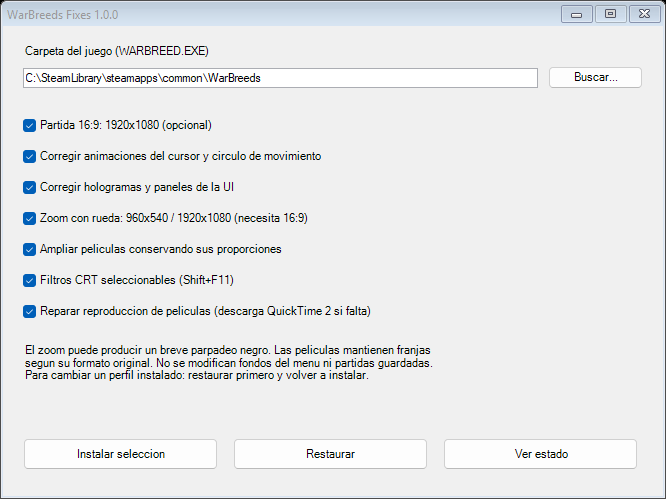

# WarBreeds Fixes

An unofficial, reversible quality-of-life patch for the verified Steam edition of WarBreeds on Windows. Choose which improvements to install, including keeping the original gameplay aspect ratio.

## Download

[Download WarBreeds Fixes 1.0.0 for Windows](https://github.com/kalilfiat/WarBreeds-Fixes/releases/download/v1.0.0/WarBreeds-Fixes-1.0.0-Public.zip) · [Release notes and SHA256 checksum](https://github.com/kalilfiat/WarBreeds-Fixes/releases/tag/v1.0.0)

Download the Public ZIP from Releases. GitHub's automatic **Source code** archives contain development files, not the ready-to-run installer.



## Features

- Optional 1920×1080 gameplay.
- Corrected cursor, movement marker, hologram and decorative panel animation timing.
- Optional mouse wheel zoom using 960×540 / 1920×1080 internal resolutions; requires widescreen and enlarges the UI when zoomed in.
- Optional proportional cinematic scaling to the main display detected at installation.
- Optional DDrawCompat 0.7.0 CRT presets and selectable filters.
- Optional local QuickTime 2 dependency repair, acquired separately by the public installer when missing.

No game executable, movies, maps, menu artwork or saved games are included. Executable changes are distributed as binary differences and applied only to the verified original. Unselected executable features have no added hooks or imported helper DLLs.

## Install / uninstall

Extract the entire Public ZIP, close the game, run `WarBreeds-Fixes.exe`, select the game directory and your options. Run the same installer and choose **Restaurar** to undo the changes. To change installed options, restore first, then install the new selection.

The installer does not need Python or administrator elevation. It targets the Windows .NET Framework. Preserve the `WarBreedsFixes` directory it creates inside your game: it contains installation-specific backups. Do not include that directory in a public release.

Supported original `WARBREED.EXE` SHA256:

```text
0e0768693a62ba89fcd5f1fd56dfcda68206d32bc6d5b5c285792996115061e3
```

Other editions and already-modified executables are rejected. Restore earlier standalone mods before using this installer. The private Personal-Offline ZIP includes the locally used QuickTime components; publish the Public ZIP.

## Known behavior

- Wheel zoom briefly blanks the screen while switching the internal display mode. It changes camera coverage and UI scale, rather than providing continuous camera zoom.
- Cinematics retain their original aspect ratio. Very wide movies have top/bottom bars; the 4:3 logo has side bars on widescreen displays.
- Movie canvas is detected at installation, up to 4096×4096; larger or unsupported desktop sizes use 1920×1080. Reconfigure after changing monitors.
- Campaign cinematics occur after winning missions 4, 8 and 12, rather than when entering a campaign.
- The original tester confirmed widescreen, animation fixes, CRT, wheel zoom and movie scaling. Installer lifecycle checks run on copies without starting the game; broader hardware validation is still welcome.

Please report the game edition, Windows version, display resolution, selected improvements and a description of the issue. Attach installer console output when relevant; avoid sharing saves or personal backups unnecessarily.

## Source and dependencies

`source/Installer.cs` contains the portable installer. `source/build_release.py` describes release assembly from the verified local development tree; it needs the original executable and existing development artifacts, which are intentionally excluded from the public archive. Local patch builders and available helper sources are included for inspection.

See `THIRD-PARTY.txt`, `LICENSE.txt`, and `licenses/DDrawCompat-LICENSE.txt`. This project is unofficial and is not affiliated with the game publisher, Steam, Apple, DDrawCompat or libretro.
